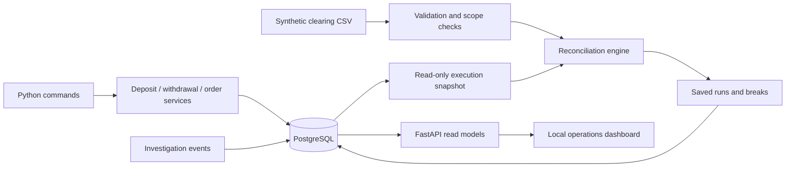

# Architecture and engineering decisions

This is a local brokerage operations simulation. It uses synthetic activity and
does not connect to a broker, exchange, bank, or clearing provider.

## Financial records

- `accounts` defines asset and liability accounts in USD.
- `journal_entries` identifies financial events by unique reference.
- `postings` records positive integer cents on a debit or credit side.
- Balances are derived from postings, not separately maintained counters.
- Deferred triggers reject incomplete or unbalanced entries at commit.
- Journal edits, deletes, and truncation are blocked by triggers. A transaction
  stamp restricts postings to the transaction that creates their entry.
- Corrections use opposite postings linked through `journal_reversals`.

These guards are ordinary database protections, not a cryptographic tamper-proof
system. A privileged database administrator can bypass them. The development
application currently uses the database owner role.

## Cash and trade lifecycle

| Event | Debit | Credit |
|---|---|---|
| Deposit | Bank cash asset | Customer available-cash liability |
| Withdrawal | Customer available-cash liability | Bank cash asset |
| Reservation | Available-cash liability | Reserved-cash liability |
| Cancellation | Reserved-cash liability | Available-cash liability |
| Execution cost | Reserved-cash liability | Clearing trade payable |
| Unused reservation | Reserved-cash liability | Available-cash liability |
| Settlement | Clearing trade payable | Bank cash asset |

An order is reserved, cancelled, or executed. A full execution has pending or
settled shares; positions are derived from those execution records. Shares are
not a separate double-entry custody ledger. Settlement is manually triggered.
Whole-share buys only: no partial fills, fees, sells, margin, or corporate actions.

## Retry and concurrency policy

Unique journal references identify requests. PostgreSQL's unique constraint and
`ON CONFLICT` arbitrate competing inserts. An existing request is compared with
its original postings; changed contents are rejected. Posting order matters.

Withdrawals and reservations lock the same available-cash account before reading
its balance. That lock remains held through commit. Order creation, cancellation,
execution, and settlement follow the same customer-account-first lock order.
This protects service operations that follow the protocol; generic journal writes,
administrative corrections, and privileged SQL can bypass spending policy.

Every service owns a transaction. Internal `_save_entry` and `_reserve_cash`
helpers reuse the caller's connection so a financial event and its business state
commit together. The intended isolation level for writes is READ COMMITTED.

## Reconciliation and evidence

Match on a shared execution reference, then compare account, symbol, whole-share
quantity, price in cents, and settlement status. Preserve duplicates and report
ambiguity instead of choosing one copy. Compare both directions to detect missing
records. Equal aggregate values do not imply matching trades.

The initial input contract is a complete account snapshot, compared against a
repeatable-read internal snapshot. External and internal observation points must
be aligned by the caller. A status mismatch is not automatically classified as a
delay. Historical cutoff queries and market calendars are not implemented.

Saved reports contain the compared records, discrepancies, creation time, source
label, and a SHA-256 fingerprint of parsed clearing records. The fingerprint is
not a hash of raw file bytes or proof of origin. Reports preserve historical
comparison evidence while dashboard balances remain live reads.

Investigation events append notes and status changes. A resolved status is an
operator declaration; it does not alter financial records, erase discrepancies,
or enforce a machine-checked link to a later clean report. Actor names are not
authenticated. Direct SQL can bypass application workflow rules.

## Verification

Unit tests cover accounting and comparison rules. HTTP tests exercise route
contracts with mocked read models. PostgreSQL integration tests cover actual
commits, rollback, retry comparison, late-posting rejection, and concurrent service
requests. Barriers coordinate worker starts but do not prove every possible
interleaving. Tests and the portfolio demo use dedicated customer accounts.

CI starts fresh PostgreSQL, installs the schema, reruns migrations, runs the demo
twice, and executes the full suite. A passing run is evidence for these scenarios,
not production certification or an unmeasured throughput claim.
